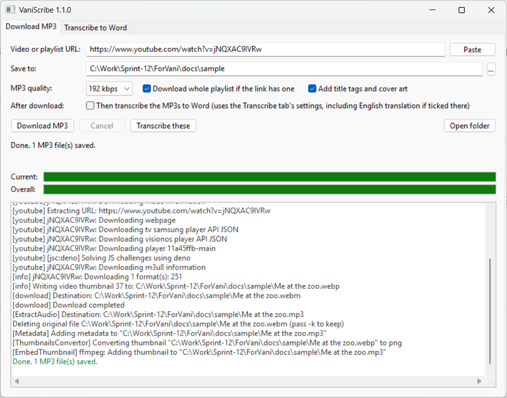
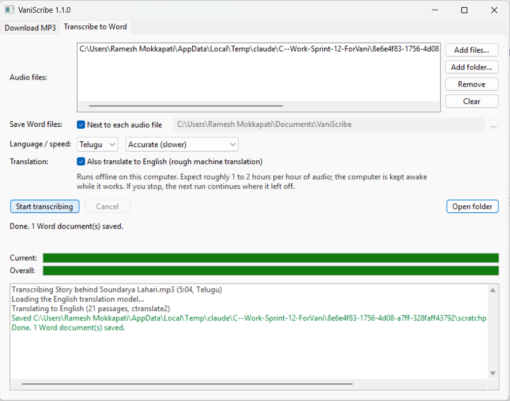

# VaniScribe

A small desktop app (wxPython) with two tabs:

- **Download MP3** saves the audio of a YouTube video, or of every video in a playlist, as MP3 files.
- **Transcribe to Word** turns Telugu speech recordings into Word documents, fully offline,
  optionally with an English translation under each paragraph.



### Download MP3

- Paste a video link or a playlist link and press **Download MP3**
- Choose the MP3 bitrate (128–320 kbps)
- Playlists go into their own sub-folder, numbered in playlist order
  (`<Save to>\<Playlist name>\001 - Title.mp3`)
- Optional title/artist tags and cover art
- Unavailable or private videos in a playlist are skipped and listed in the log
- Cancel at any time; settings are remembered between runs
- **Then transcribe** (off by default): tick *Then transcribe the MP3s to Word* and the new MP3s
  go straight to the Transcribe tab and start, with that tab's settings (including English
  translation if ticked there). Or press **Transcribe these** after a download to add the new
  MP3s to the Transcribe tab's list and start them yourself.

Only download content you own or have permission to download.

### Transcribe to Word



- Add MP3 (or M4A, WAV, …) files you already have, or a whole folder, or drag them onto the
  list, then press **Start transcribing**
- Each recording becomes a `.docx` with the Telugu text in paragraphs, each starting with a
  `[mm:ss]` time so you can find the place in the audio; saved next to the audio or in a folder you pick
- Runs entirely on the computer: no internet, account or fees. Expect roughly 1–2 hours of
  processing per hour of audio on a typical laptop (**Faster** mode cuts that by about a third)
- The computer is kept awake while it works; if you stop (or it's interrupted), the next run
  continues from where it stopped
- Accuracy: everyday Telugu is good; names and Sanskrit verses have more mistakes, so treat the
  document as a first draft to proofread
- Optional **English translation** (off by default): tick *Also translate to English* and each
  Telugu paragraph gets an English version underneath, in blue italics. It is a rough machine
  translation that conveys the gist, not an exact rendering. Known names and terms (Soundarya
  Lahari, Sri Vidya, Brahma Vidya, Adi Shankaracharya, Sri Chakra, …) are kept as names instead
  of being translated word by word; add your own in `%LOCALAPPDATA%\VaniScribe\glossary-te.txt`,
  one per line, e.g. `లలితా సహస్రనామం = Lalita Sahasranama`.
  Extra time per hour of audio: a few minutes on 64-bit Windows and on Macs; roughly 30–90 minutes on an
  older 32-bit laptop.

Under the hood: [whisper.cpp](https://github.com/ggml-org/whisper.cpp) with
[vasista22/whisper-telugu-small](https://huggingface.co/vasista22/whisper-telugu-small)
(Whisper fine-tuned on Telugu by IIT Madras), converted to 8-bit. Audio is cut at pauses into
pieces of at most 6 seconds; Telugu needs ~15 tokens per word, so Whisper's usual 30-second
windows silently lose most of the speech.

Translation uses Meta's [NLLB-200 distilled 600M](https://huggingface.co/facebook/nllb-200-distilled-600M)
with 8-bit weights. The 64-bit Windows and Mac builds run it with [CTranslate2](https://github.com/OpenNMT/CTranslate2);
the 32-bit Windows build, where no translation engine is available, runs the same model file with
VaniScribe's own numpy implementation (`ytmp3/nllb.py`). NLLB is licensed CC BY-NC 4.0:
**personal, non-commercial use only**.

## Use it on Windows

There are two Windows builds. Pick the one that matches the PC's Windows
(Settings → System → About → **System type**):

| System type | Use |
| --- | --- |
| 64-bit operating system, x64-based processor | `VaniScribe-x64.zip` |
| 32-bit operating system | `VaniScribe-x86.zip` |

Using the x64 build on 32-bit Windows gives "This app can't run on your PC".
The x86 build also runs on 64-bit Windows, just a little slower.

Download the zip from the GitHub Actions run (artifact) or the GitHub Release, right-click →
**Extract All**, and run `VaniScribe-<arch>.exe` from the extracted folder. Keep the `models`
folder next to the exe: it holds the speech model (~250 MB) and the translation model
(~620 MB) the Transcribe tab needs. FFmpeg,
whisper.cpp and a JavaScript runtime yt-dlp needs for YouTube (Deno in x64, Node.js in x86)
are inside the exe. The first launch takes a few seconds while it unpacks.

When copying to another PC by USB, copy the zip and use **Eject** before unplugging the
drive; an incomplete copy gives "This app can't run on your PC".

## Use it on a Mac

There are two Mac builds (macOS 11 Big Sur or later). Check  → **About This Mac**:

| Chip / Processor | Use |
| --- | --- |
| Apple M1, M2, M3, M4… | `VaniScribe-macos-arm64.zip` |
| Intel | `VaniScribe-macos-x64.zip` |

Unzip it and drag **VaniScribe.app** into **Applications**. Everything is inside the app:
FFmpeg, Deno, the whisper.cpp speech engine, and the speech and translation models, so the
download is about 1 GB. On Apple Silicon, transcription uses the Mac's GPU (Metal) and is much
faster than on a Windows laptop; English translation uses CTranslate2 on both kinds of Mac.

The app isn't signed with an Apple Developer ID, so the first time you open it macOS says
it "cannot be opened" or "cannot verify the developer". To allow it once:

- **macOS 15 Sequoia and later:** try to open it, click **Done**, then go to
  **System Settings → Privacy & Security**, scroll down and click **Open Anyway**.
- **macOS 11–14:** right-click (or Control-click) VaniScribe.app → **Open** → **Open**.

After that it opens normally.

## Run from source

```powershell
py -3.13 -m venv .venv
.venv\Scripts\python -m pip install -r requirements.txt
.venv\Scripts\python run_app.py
```

On a Mac, use `python3 -m venv .venv` and `.venv/bin/python run_app.py` instead.

FFmpeg must be on `PATH` or in `vendor/<platform>/bin` (running the build script once puts it
there). Deno or Node.js 22+ is strongly recommended too: yt-dlp needs a JavaScript runtime to
read most YouTube formats. For transcription, `whisper-cli` must be in the same place and the
model in `models\` (see below).

## Build locally

### Windows

```powershell
.\prepare_model.ps1        # once: builds the speech and translation models in models\ (~3.5 GB download)
.\build.ps1                # 64-bit: dist\VaniScribe-x64.zip
.\build.ps1 -Arch x86      # 32-bit: dist\VaniScribe-x86.zip
```

`prepare_model.ps1` downloads the Telugu speech model and converts it to whisper.cpp's format
(8-bit), and downloads NLLB-200 and converts it to CTranslate2 (8-bit). It needs 64-bit Python
and sets up its own `.venv-model` with PyTorch (CPU), transformers and CTranslate2; both Windows
builds then use the result. Models that already exist are skipped.

`build.ps1` builds `dist\VaniScribe-<arch>.exe` and packages it with `models\` into
`dist\VaniScribe-<arch>.zip`. Add `-Clean` to start from scratch, or `-NoModel` for a
download-only package. Each architecture gets its own virtual environment
(`.venv` / `.venv-x86`) and tools folder (`vendor\x64\bin` / `vendor\x86\bin`). For x86, a
32-bit Python is used if installed (`py -3.13-32`); otherwise a private copy is downloaded
into `tools\`.

### macOS

PyInstaller can't build a Mac app on Windows, so build on a Mac or let the GitHub pipeline do
it. You need Python 3.10+ (python.org or Homebrew), the Xcode Command Line Tools
(`xcode-select --install`) and CMake (`brew install cmake`):

```bash
bash build_macos.sh --prepare-models   # first time: also builds models/ (~3.5 GB download)
bash build_macos.sh                    # later builds; add --clean to start from scratch
```

It builds for the Mac's own chip: `dist/VaniScribe.app` plus `dist/VaniScribe-macos-arm64.zip` on
Apple Silicon, or `-macos-x64.zip` on Intel. whisper.cpp is compiled from source (v1.9.5, the
same version as Windows; Metal GPU on Apple Silicon), and the models from `models/` are copied
inside the app bundle. FFmpeg comes from a pinned [martin-riedl.de](https://ffmpeg.martin-riedl.de/)
release and is SHA-256 checked.

## Build pipeline (GitHub Actions)

`.github/workflows/build.yml` builds the speech model once (cached until its script changes),
then all four versions in parallel:

| Job | Runner | Output |
| --- | --- | --- |
| Models | `windows-latest` | `models\` (speech + translation) shared with both Windows builds |
| Windows x64 | `windows-latest` | `VaniScribe-x64.zip` (exe + model) |
| Windows x86 | `windows-latest` (32-bit Python) | `VaniScribe-x86.zip` (exe + model) |
| macOS Apple Silicon | `macos-15` | `VaniScribe-macos-arm64.zip` (app with models inside) |
| macOS Intel | `macos-15-intel` | `VaniScribe-macos-x64.zip` (app with models inside) |

| Trigger | Result |
| --- | --- |
| Push to `main`, pull request, manual run | each build uploaded as a workflow artifact |
| Push a tag like `v1.0.0` | all four also attached to a GitHub Release |
| Every Monday | rebuild with the newest yt-dlp |

YouTube changes its site often. When downloads start failing, rebuilding picks up
the latest yt-dlp, which is usually the fix.

## Project layout

```
run_app.py                 entry point (source and exe)
ytmp3/gui.py               wxPython window: Download MP3 and Transcribe to Word tabs
ytmp3/downloader.py        yt-dlp download/convert engine (background thread)
ytmp3/transcriber.py       offline speech-to-text: pause-based chunking + whisper.cpp (background thread)
ytmp3/docx_writer.py       Word output with Telugu-ready fonts and timestamped paragraphs
ytmp3/nllb.py              Telugu -> English translation: CTranslate2, or a numpy engine on 32-bit
ytmp3/glossary.py          names and Sanskrit terms kept as English names during translation
ytmp3/tools.py             finds bundled tools (FFmpeg, Deno/Node, whisper-cli) and models
ytmp3.spec                 PyInstaller build definition (Windows exe / macOS .app)
build.ps1                  Windows build script (local + CI)
prepare_model.ps1          builds the Telugu speech model (scripts/prepare_model.py)
scripts/build-common.ps1   download helpers shared by the Windows scripts
build_macos.sh             macOS build script (local + CI)
version_info.txt           Windows file version resource
```
